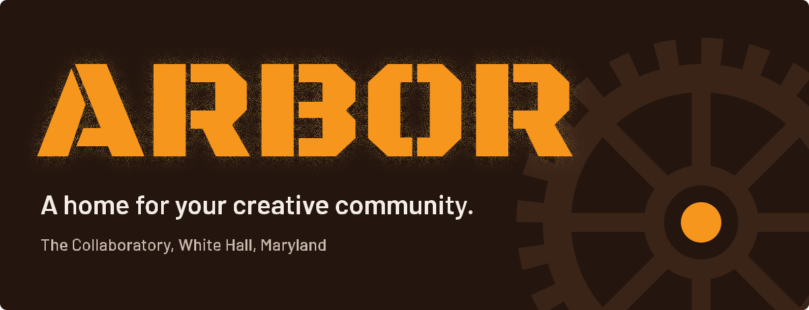
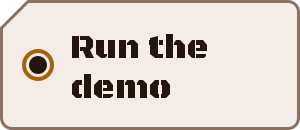
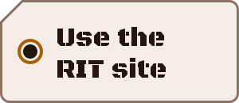
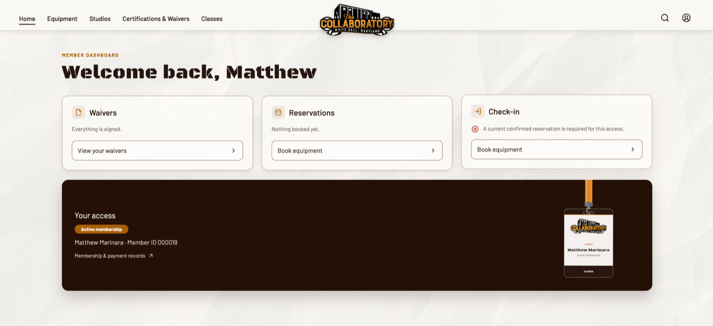
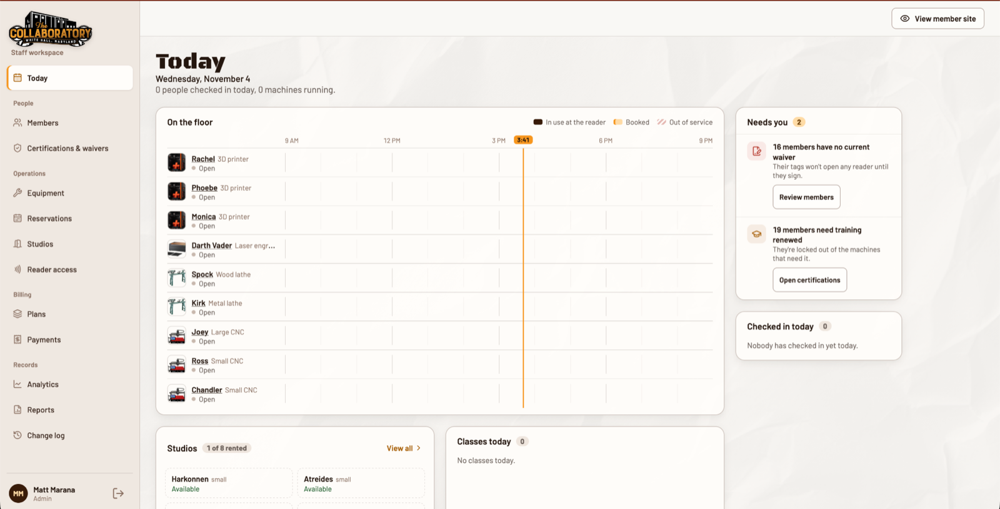
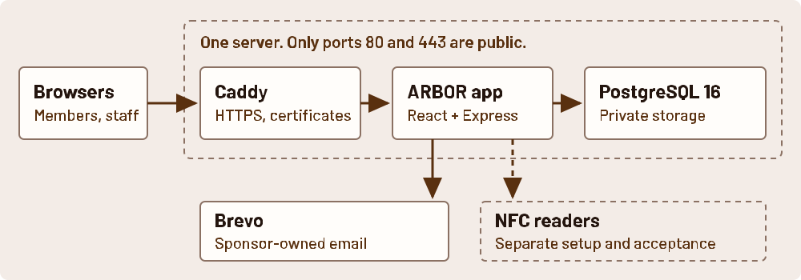

<p align="center"></p>

ARBOR is The Collaboratory’s member site and staff workspace. Members handle
memberships, reservations and waivers in one place. Staff run the studio from a
permission-controlled workspace with an audit trail for changes.

<p align="center"><a href="docs/SPONSOR-HANDOFF.md"></a> <a href="#run-the-demo"></a> <a href="docs/rles-team-quick-start.md"></a></p>

Studio owners start with the illustrated, beginner-first
[sponsor guide](docs/SPONSOR-HANDOFF.md) (also a
[printable PDF](docs/print/ARBOR-Sponsor-Guide.pdf)). Developers can
[run the demo](#run-the-demo) in one command. Team members reach the shared
deployment through [RLES](docs/rles-team-quick-start.md).

## Run the demo

Install **Node.js 24.22.1+ (24.x)** and Docker Desktop with Compose, start Docker,
then run this from the repository root:

```sh
npm run dev
```

Open **http://localhost:5173** and choose **Member demo** or **Admin demo**. The
launcher installs dependencies and starts an isolated sample PostgreSQL database.
To send real confirmation email, configure the
[documented settings](docs/LOCAL-DEVELOPMENT.md) and use `npm run dev:email`.

> [!CAUTION]
> `compose.mvc.yml` has development-only database authentication and sample
> accounts. Never expose it as the live site. Use the
> [sponsor hosting files](docs/hosting/) instead.

## What’s in it

| For members | For the studio team |
| --- | --- |
|  |  |
| Register and confirm an email address | Manage members, plans and facility eligibility |
| Review memberships, day passes and payment records | Issue memberships and record external payments |
| Sign required waivers and review certifications | Publish approved policies and manage training |
| Reserve equipment, rooms and monthly studios, and enroll in classes | Review bookings, reports and staff change history |
| See access eligibility and check-in status | Manage role-based permissions and reader access records |

## Before you invite members

ARBOR works today, but a few launch steps are still open. Check these against the
[launch checklist](docs/SPONSOR-HANDOFF.md#10-launch-checklist).

| Area | Status | What that means |
| --- | --- | --- |
| Card payments | **Test mode only** | The current configuration rejects live Stripe payments. |
| Door and reader access | **Needs a site test** | Physical hardware needs its own configuration and acceptance test. |
| Email, DNS and recovery | **Verify per install** | Confirm email delivery (sign-up and password reset depend on it), real DNS and a data restore on your server. |
| Policies and prices | **Sponsor approval** | The sponsor reviews these before members see them. |

## How it fits together



| Layer | Built with |
| --- | --- |
| Frontend | React 19, TypeScript, Vite 8 |
| Backend | Express 5, Node.js 24, signed JWT authentication |
| Data | PostgreSQL 16, versioned migrations, audited staff changes |
| Hosting | Docker Compose, Caddy HTTPS, persistent database storage |
| Integrations | Brevo email, Stripe test mode, authenticated reader integration |

## Documentation

<details open>
<summary><strong>Run the studio</strong></summary>

- [Sponsor setup and operations](docs/SPONSOR-HANDOFF.md) covers AWS Lightsail or any
  equivalent Ubuntu server, first administrator, backups and recovery. No AI
  assistant required.
- [Team handoff](docs/TEAM-HANDOFF.md) walks through membership and access workflows.
- [Email notifications](docs/EMAIL-NOTIFICATIONS.md) covers sender, worker and
  notification setup.
- [Guided reader setup](docs/reader-guided-setup.md) connects a new reader from the
  staff workspace.

</details>

<details>
<summary><strong>Build on it</strong></summary>

- [Local development](docs/LOCAL-DEVELOPMENT.md): setup, demo accounts, email mode,
  troubleshooting
- [Architecture](docs/MVC.md): MVC structure and integration points
- [Load testing](docs/LOAD-TESTING.md): peak check-in bursts, validation deadlines,
  sustained access tests and CI performance checks
- [Authentication](docs/JWT-AUTH.md): JWT signing keys and session behavior
- [Email-only accounts](docs/email-only-accounts.md): registration, sign-in and
  password recovery
- [Equipment payments](docs/equipment-payments.md): Stripe test-mode checkout
  for equipment reservations
- [Role-based access](docs/rbac.md): staff roles and permission rules
- [Scheduling](docs/scheduling-pr26.md): reservation rules and upgrade compatibility
- [Studio rentals](docs/studio-rentals.md): monthly studios and Stripe test mode
- [LED relay prototype](docs/NFC-LED-PROTOTYPE.md): NFC reader states and prototype
  limits

</details>

<details>
<summary><strong>Use the shared RIT site</strong></summary>

- [RLES access guide](docs/rles-team-quick-start.md): connect as a team member
- [Automatic deployment](docs/AUTO-DEPLOYMENT.md): CI-gated deploys from `main`
- [Environment boundaries](docs/UNIFIED-ENVIRONMENT.md): read before looking up
  website accounts in SQL. The public site, NFC demo and legacy SQL connection use
  separate datasets.

</details>

<details>
<summary><strong>Check the evidence</strong></summary>

- [Requirements traceability](docs/REQUIREMENTS-TRACEABILITY.md)
- [Primary verification](docs/PRIMARY-VERIFICATION.md)
- [NFC acceptance results](docs/NFC-ACCEPTANCE-2026-10-16.md)

</details>

## Working with the database

Schema files live in `ddl/`. Incremental changes live in `database/migrations/`.

> [!WARNING]
> The legacy creation scripts **drop and recreate objects**, and the insert script
> loads synthetic data. Never run them on shared or production records. To install
> or restore, follow the [sponsor guide](docs/SPONSOR-HANDOFF.md), which separates
> an empty new install from a restore into a new empty database.

---

<sub>Built by Team ARBOR for the RIT Senior Development Project. Hosting instructions describe a separate sponsor installation, not an already-provisioned cloud service.</sub>
