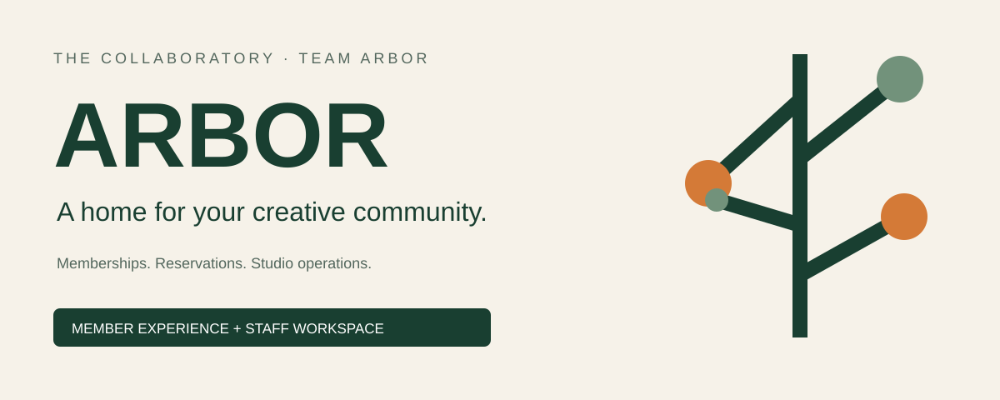
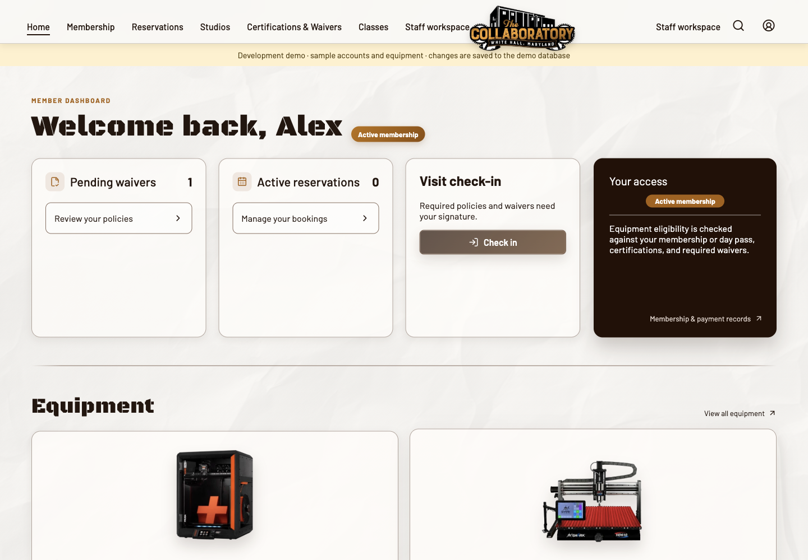
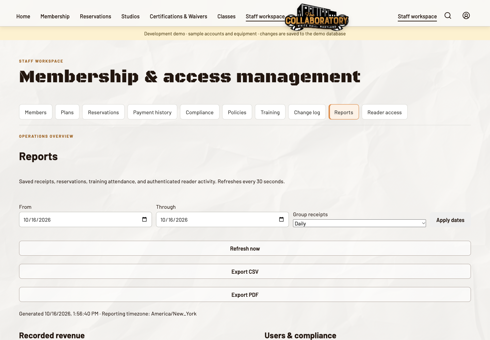

<p align="center"></p>

<p align="center"><strong>The Collaboratory’s member experience and staff workspace.</strong><br>Built by Team ARBOR · RIT Senior Development Project</p>

<p align="center">
<a href="docs/SPONSOR-HANDOFF.md">Sponsor setup guide</a> ·
<a href="docs/LOCAL-DEVELOPMENT.md">Run locally</a> ·
<a href="docs/TEAM-HANDOFF.md">Developer handoff</a> ·
<a href="docs/REQUIREMENTS-TRACEABILITY.md">Requirements & evidence</a>
</p>

## Creative space. Connected operations.

ARBOR brings member accounts, membership access, equipment and room reservations,
waivers, training records and studio operations into one application. Members see
their own information; staff work from a permission-controlled workspace with an
audit trail for changes.


*Actual application, running locally with synthetic demonstration records. Not a production account.*

### What you can do

| For members | For the studio team |
| --- | --- |
| Register and confirm an email address | Manage members, plans and facility eligibility |
| Review memberships, day passes and payment records | Issue memberships and record external payments |
| Sign required waivers and review certifications | Publish approved policies and manage training |
| Reserve equipment, rooms and monthly studios | Review bookings, reports and staff change history |
| See access eligibility and check in | Manage role-based permissions and reader access records |


*Staff workspace in the isolated local demo. Report controls are shown with synthetic data.*

## Start in the right place

**Steph / studio owner:** use the illustrated **[Sponsor setup & operations guide](docs/SPONSOR-HANDOFF.md)**.
It covers a new AWS Lightsail installation, an equivalent Ubuntu server elsewhere,
first-administrator setup, backups and recovery. No AI assistant is required.
A [printable PDF](docs/print/ARBOR-Sponsor-Guide.pdf) is included.

**Developer:** install **Node.js 24.22.1+ (24.x)** and Docker Desktop with Compose,
start Docker, then run this from the repository root:

```sh
npm run dev
```

Open **http://localhost:5173**, then choose **Member demo** or **Admin demo**.
The launcher installs application dependencies and starts an isolated sample
PostgreSQL database. [Full local setup and troubleshooting →](docs/LOCAL-DEVELOPMENT.md)
For real confirmation email during development, configure the documented email
settings before using `npm run dev:email`.

**Team member connecting to the shared RIT environment:** use the
[RLES access guide](docs/rles-team-quick-start.md). The sponsor-hosting template is
separate; it does not move or replace the current shared deployment.
The shared RIT site uses [CI-gated automatic deployment from `main`](docs/AUTO-DEPLOYMENT.md).

> **Demo is not production.** `compose.mvc.yml` contains development-only database
> authentication and sample accounts. Never expose that stack as the live site.
> Use the separate [sponsor hosting files](docs/hosting/) for the reviewed hosting path.

## How it fits together


- **Frontend:** React 19 · TypeScript · Vite 8
- **Backend:** Express 5 · Node.js 24 · signed JWT authentication
- **Data:** PostgreSQL 16 · versioned migrations · audited staff mutations
- **Hosting template:** Docker Compose · Caddy HTTPS · persistent database storage
- **Integrations:** Brevo confirmation/notification email; Stripe **test mode**;
  authenticated physical-reader integration with separate hardware setup

### Release boundaries worth knowing

This repository is a working application, not a promise that every sponsor launch
step is complete. **Live Stripe payments are not supported by the current key
configuration**; only test keys are accepted. Physical access needs a separate
hardware/configuration acceptance test. The login page’s forgotten-password UI
is not a completed password-reset service. Email delivery, real DNS, data recovery
and the sponsor’s policies/prices need verification before inviting members.
See the [launch checklist and validation boundary](docs/SPONSOR-HANDOFF.md#10-launch-checklist).

## Documentation map

| You need… | Read… |
| --- | --- |
| A beginner-first hosting and operations walkthrough | [Sponsor handoff](docs/SPONSOR-HANDOFF.md) |
| Local setup, demo accounts and email mode | [Local development](docs/LOCAL-DEVELOPMENT.md) |
| Membership/access workflows and an app walkthrough | [Team handoff](docs/TEAM-HANDOFF.md) |
| NFC reader states, prototype limits and physical test results | [LED relay prototype](docs/NFC-LED-PROTOTYPE.md) · [NFC acceptance](docs/NFC-ACCEPTANCE-2026-10-16.md) |
| MVC structure and integration points | [Architecture](docs/MVC.md) |
| JWT signing keys and session behavior | [Authentication](docs/JWT-AUTH.md) |
| Staff roles and permission rules | [Role-based access](docs/rbac.md) |
| Email sender, worker and notification setup | [Email notifications](docs/EMAIL-NOTIFICATIONS.md) |
| Monthly studios and Stripe test-mode configuration | [Studio rentals](docs/studio-rentals.md) |
| Reservation rules and upgrade compatibility | [Scheduling](docs/scheduling-pr26.md) |
| Requirements, evidence and verification history | [Traceability](docs/REQUIREMENTS-TRACEABILITY.md) · [Primary verification](docs/PRIMARY-VERIFICATION.md) |

## Working with the database

Schema files live in `ddl/`; incremental changes live in `database/migrations/`.
The legacy creation scripts **drop/recreate objects**, and the insert script loads
synthetic data. They are not an upgrade or recovery procedure. Never run them over
shared or production records. The sponsor guide separates an **empty new install**
from a **restore into a new empty database**, and includes backups before reviewed
migrations. Existing member data must be preserved.

---

<sub>Visuals are repository-owned SVG diagrams and screenshots of this application’s local sample-data demo. Hosting instructions describe a separate sponsor installation, not an already-provisioned cloud service.</sub>
