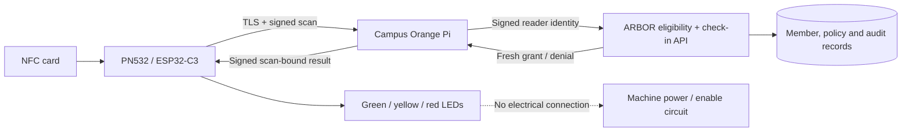

# NFC machine-access prototype: LED-only relay stand-in

Raw verification JSON files named below are retained separately by the project team; this repository contains the reviewable test summary, not credentials or private reader dumps.

## What this prototype demonstrates

A real NFC card is read by a PN532 attached to an ESP32-C3. The ESP32 initiates an authenticated HTTPS exchange with the campus Orange Pi, which requests an equipment-specific decision from the ARBOR backend. Database-backed eligibility determines the LED result. The assigned target is the demo 3D Printer, equipment3; the reader cannot choose an arbitrary machine.

**The LEDs are a visible stand-in for an actuator. They do not switch, lock, unlock, energize or interrupt the actual machine.**

## Existing assembly: no wire changes

- Controller: ESP32-C3 SuperMini, native USB for power/programming.
- NFC: PN532 I2C; SDA GPIO0, SCL GPIO1.
- Green LED: GPIO5, active-high.
- Yellow LED: GPIO6, active-high.
- Red LED: GPIO7, active-high.
- No relay output is configured or connected.

## State indications

| State | Indication | Meaning |
|---|---|---|
| Locked / ready | Red steady | Reader/backend ready, no current authorization indication. |
| Checking | Red blink | Fresh card scan awaiting its own authorization result. |
| Approved | Green, bounded to at most2seconds | Backend allowed this card for this reader's assigned machine; not proof of machine operation. |
| Denied | Red flashes, then ready/red | Backend denied the presented card. |
| Fault / unavailable | Yellow blink, green off | Missing reader, unavailable Wi-Fi/gateway/backend, or missing/failing controller heartbeat. |

No success color is permitted simply because the UID was read, uploaded or stored. Expired backend decisions, replies for another scan/session, replayed counters and invalid signatures cannot grant access. Heartbeats do not extend an old green indication. A lost connection invalidates authorization; reconnection requires a fresh usable state and does not restore an old grant.

## Check-in identity behavior

The backend resolves the UID to a registered card/member, evaluates eligibility, returns the member's ID/name/email/membership/day-pass flags on approval, and records an approved check-in when requested. The Pi check-in adapter now preserves those identity fields in its signed reply and a private proof record. Names/emails are not added to the general status file.

Unassigned, expired or inactive/ineligible cards must not create approved check-ins. Membership-only tests control for reservations, waivers, account status and machine certification so that the intended eligibility rule is actually tested. A timed staff test override supplies a bounded supervised reservation when needed; it cannot bypass membership, waiver, training or account checks.

## Evidence and boundaries

- Prior physical card/authorization/green evidence exists for the original bridged implementation. It is not relabeled as new direct-transport evidence.
- Direct ESP32-to-Pi transport, actual idle gateway-loss/recovery and an actual green-grant connection failure/recovery are verified without the Mac authorization tunnel. No stale grant returned after recovery.
- Actual Pi-to-backend route interruption and restoration are recorded separately in `backend-outage-proof.json`.
- Earlier firmware host-only reset exposed a PN532 stuck-clock condition; controlled USB port power cycling recovered it without manual action. Updated firmware then passed three consecutive host-only reset/recovery trials without a Mac authorization controller. Power cycling remains an operator-maintenance fallback, not an ESP32-autonomous PN532 power reset.
- Three-account signed API matrix: active → allowed/correct name+email/one approved check-in; expired → ENTITLEMENT_REQUIRED/no check-in; inactive/suspended membership → ENTITLEMENT_REQUIRED/no check-in. These are API tests, not three physical card presentations.
- Direct real-tap identity/check-in/green evidence passed (event32/check-in5). Actual expired and inactive membership retaps were denied with red flashes/no green/no added check-in (events36/37); original test membership restored. See [acceptance results](NFC-ACCEPTANCE-2026-10-16.md).

## Physical relay acceptance still required

SDTA-134 remains open for real machine actuation. Before closing physical integration:

1. Approve and document the actual installed actuator, machine interface and wiring.
2. Define output polarity, safe/off state, boot state and independent watchdog/lease behavior.
3. Demonstrate that valid authorization enables the intended machine only.
4. Demonstrate that denial, revocation, timeout, network/backend loss, controller reset and power loss remove machine enable as intended.
5. Verify no stale authorization re-enables the machine after recovery; record actual equipment observations and sponsor/installer acceptance.

A gate-review simulation may cite this LED demonstration if accepted as a prototype, but its report and Jira status must not claim physical machine switching was tested.

## Gate-review software relay acceptance

See [time limits and simulated relay acceptance](TIME-LIMITS-RELAY-ACCEPTANCE.md) for SDTA-204/134 expiry, incident and forced re-certification tests. The ticket permits a simulated relay; physical switching remains a separate unverified milestone.
