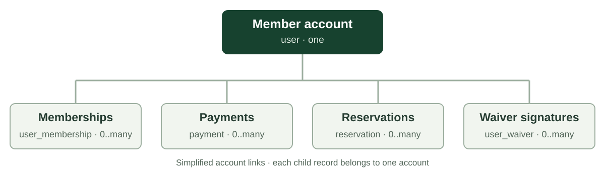

# ARBOR Database Overview

**Prepared for:** The Collaboratory  
**Prepared by:** Team ARBOR · RIT Senior Development Project  
**Date:** November 23, 2026

**Status:** Sponsor review draft

## 1. Purpose and business value

ARBOR's database provides the shared record system behind The Collaboratory's member website and staff workspace. It connects member accounts, memberships, payments, reservations, training, signed waivers, and access activity so staff can manage daily operations using related information in one application.

For example, a member's equipment reservation is connected to their account and the selected machine. The application checks the member's applicable membership or pass, required waiver, training, account restrictions, and reservation conditions before allowing the relevant booking or access action. These decisions use database records rather than relying on information entered in the browser alone.

### What the database contributes

- **Consistent member records:** Staff can connect a person's membership, booking, payment, and compliance history through a common account.
- **Safer scheduling:** Database rules prevent overlapping active reservations for the same equipment or room, including requests submitted at the same time.
- **Traceable decisions:** Staff changes and access activity create records that support follow-up, reporting, and review.
- **Continuity:** Persistent storage and documented backup and recovery procedures support operation beyond the student project.

### How it fits into ARBOR

**Member or staff browser → ARBOR application → PostgreSQL database**

Authenticated reader requests also reach the application, which evaluates the relevant database records and records access activity. Within one configured application environment, website and reader routes use the same database connection pool. Physical reader operation requires separate site acceptance.

The project uses **PostgreSQL 16**, a relational database that stores linked records in tables. The backend manages database access, permissions, and business rules. The sponsor hosting template keeps the database on a private container network and stores its data in a persistent Docker volume. Browsers communicate with the application through HTTPS. [1, 2]

<!-- pagebreak -->

## 2. Information stored and how it connects

The original schema defines the core business records. Versioned migrations extend that foundation for the application's later workflows. Reviewing the original creation script alone does not describe the complete current design. [3, 4]

| Information area | Representative tables | Purpose for The Collaboratory |
| --- | --- | --- |
| Member accounts and permissions | `user`, `role`, `user_role`, `permission`, `role_permission` | Connect identity and account status with the actions a person may perform. |
| Memberships and day passes | `membership_tiers`, `user_membership`, `day_pass` | Define offers and record the access periods issued to each member. |
| Payments and billing | `payment`, `app_membership_billing`, `app_membership_invoice` | Retain amounts, statuses, staff or provider references, and links to memberships or billing periods. |
| Facilities and scheduling | `building`, `room`, `equipment`, `reservation`, `app_studio_rental` | Identify resources and connect members to equipment, room, and studio bookings. |
| Waivers and signed copies | `waiver`, `user_waiver`, `app_signed_waiver_copy` | Preserve policy versions, signature records, and available signed-document copies. |
| Certifications and training | `certifications`, `user_certifications`, `app_training_class`, `app_training_enrollment` | Record requirements, approvals, renewal dates, scheduled classes, and enrollment outcomes. |
| Visits and reader activity | `check_in`, `app_facility_visit`, `app_access_reader`, `app_device_access_event` | Support check-in history, reader configuration, and access-decision review. |
| Accountability and communications | `app_staff_audit`, `app_notification_outbox`, `app_migration` | Track changes, queued notifications, and the schema updates applied to an installation. |

### Main relationships



This simplified map shows one account with zero or more related records. Payments can also reference a membership, reservations connect to equipment or rooms, and waiver signatures identify a policy version. Members also have check-in history and certification assignments; classes and enrollments support their training workflow.

Shared definitions, such as membership plans and certification types, are separate from individual assignments to reduce repeated data and support consistent updates. Issued plans retain snapshots so later pricing changes do not rewrite earlier terms. Selected snapshots and document payloads use PostgreSQL's JSONB format alongside the relational tables. [3, 4]

<!-- pagebreak -->

## 3. Reliability, security, and accountability

### Preventing inconsistent records

**Linked-record checks.** Primary keys identify records, and foreign keys connect them to valid related records. Unique constraints prevent duplicates where required, including case-insensitive account email addresses and repeated assignments of the same role to the same user.

**Reservation protection.** PostgreSQL exclusion constraints reject overlapping pending or confirmed reservations for the same equipment or room. Valid-time checks reject an end time that is not after the start time. These protections apply at the database level, including when two booking requests arrive together.

**Complete transactions.** Related writes commit together or roll back on failure. For example, membership issuance can save its entitlement, payment record, and audit information as one operation, avoiding a partially completed result.

**Protection against retries and conflicting edits.** Request identifiers and stored payment-provider event identifiers help prevent duplicate processing. Revision fields let the application detect an outdated staff edit instead of silently overwriting a newer change. These controls apply to the workflows that implement them. [4, 5]

### Protecting access and sensitive information

The application checks authenticated identity, permissions, and record ownership. Members receive access to their own permitted records; staff functions require the applicable privileges. Authorization reloads role assignments from the database, so a role change does not depend solely on older sign-in claims. New account passwords are stored as bcrypt hashes. Queries use bound parameters in the reviewed database workflows. [5, 6]

The sponsor hosting template does not publish the database port to the internet. Database and application secrets are supplied through protected configuration files. Backups contain sensitive member information and require restricted storage and access. Hosting configuration, backup encryption, and operating procedures must be verified on the sponsor's installation. [2]

### Preserving a useful history

Application audit entries record business actions, and database triggers capture change metadata on covered tables without copying credentials or full row payloads into those automatic entries. Audit-table triggers reject ordinary updates, deletions, and truncation. These controls support accountability; they do not prevent a privileged database operator from changing the database's protections.

Waiver versions and member signatures are retained separately. A dedicated signed-copy table preserves available signing-time document payloads independently of notification cleanup. Earlier signatures without a stored copy require individual review; the existence of a signature row does not establish that its original document can be reconstructed. [4]

<!-- pagebreak -->

## 4. Installation, maintenance, and data preservation

### Controlled schema changes

Schema changes are delivered through versioned SQL migration files. The migration runner applies pending numbered SQL files in filename order, records a SHA-256 checksum for each file, and rejects changes to an already applied migration. The numbered SQL changes and their migration-history entries commit together in one transaction. A session-level advisory lock prevents simultaneous migration runs. [5]

After that transaction commits, the runner completes online database changes outside the transaction while retaining the same advisory lock. If this online phase fails, the committed SQL changes and history remain in place. A retry verifies the stored checksums and attempts the online work again, even when no numbered SQL files are pending. Operators must review the command result and application health before accepting an update; committed migration-history rows alone do not prove the online phase completed. [5]

The legacy creation scripts include destructive statements, and the insert script loads synthetic data. Existing installations must follow the documented migration or recovery path. A new sponsor installation starts without sample member and business records. [1, 2, 3]

### Starting point for the next database maintainer

Confirm that the incoming maintainer can access the repository and check out the selected reviewed release using [Sponsor Handoff, Section 4](SPONSOR-HANDOFF.md#4-install-the-tools-and-obtain-the-reviewed-software). Record the release commit, environment, technical owner, and support contact before making database changes. The procedures below run on the intended sponsor server from the repository root.

| Task | Procedure and expected check |
| --- | --- |
| Initialize an empty database | Follow [Section 6, Path A](SPONSOR-HANDOFF.md#path-a--genuinely-new-studio-database): `bash docs/hosting/arbor.sh initialize-new`. Use only an intended empty installation; the helper refuses existing public tables and does not load sample business records. |
| Restore existing records | Follow [Section 6, Path B](SPONSOR-HANDOFF.md#path-b--move-or-recover-existing-records): `restore-new` with a verified archive and matching release/history. Compare member counts, memberships, policies, certifications, and recent transactions with the source before approving any required migrations. |
| Apply a reviewed update | Follow [Section 12](SPONSOR-HANDOFF.md#12-updates-and-rollback): preserve a recoverable backup, record the current version, review compatibility, build the selected release, and use the helper's `migrate` command when required. Verify completion of both migration phases, service health, and critical workflows. |
| Verify recovery | Follow [Section 11, Prove you can recover](SPONSOR-HANDOFF.md#prove-you-can-recover): restore into a separate empty installation with email and hardware integrations disabled. Check linked member records, payments, waivers and signed copies, permissions, and migration history. Record the archive, release, operator, date, and observed outcome. |

For staff training, use the [Team Handoff walkthrough](TEAM-HANDOFF.md#suggested-end-to-end-walkthrough) as the basis for issuing memberships and recording external payments. Pair it with [Sponsor Handoff, Section 9](SPONSOR-HANDOFF.md#9-configure-the-studio-and-rehearse-the-workflows) to rehearse waiver and training eligibility checks on the selected release. Record which staff completed each workflow and any unresolved issues. Earlier walkthroughs describe their recorded project version; confirm current screens and behavior during rehearsal.

<!-- pagebreak -->

### Backups and recovery

The sponsor operations helper creates a PostgreSQL custom-format archive and checks that PostgreSQL can read its archive index. A persistent database volume protects records across ordinary container replacement, but it does not replace a backup.

The handoff procedure calls for private off-server backup copies, protected configuration and secret-file recovery copies, and a restore rehearsal into a separate empty installation. After restoration, the operator should verify linked member records, memberships, payment history, signatures and signed-copy retrieval, permissions, and migration history.

The supplied backup command is manual. Automated scheduling, monitoring, retention, and recovery targets must be assigned and verified before routine operation. The sponsor should agree how much recent data may be lost and how quickly service must be restored; this document does not claim those targets have been established. [2]

### Keeping environments separate

Local demos, shared school deployments, and the eventual sponsor installation are separate environments. Earlier project inventories identified different datasets behind the public website, NFC demo, and legacy SQL connection. Database names alone do not establish which records are authoritative.

Before any transfer, the team must identify the intended source, inventory records and configuration, rehearse recovery, and review identity and resource mappings. Accounts, access-card identities, payment references, waiver versions, and audit provenance need particular attention. The repository's cutover proposal does not automatically combine datasets or establish that a cutover occurred. [7]

### Ongoing responsibilities

The sponsor should designate a technical operator to maintain backups, review database and application health, monitor storage growth, apply reviewed updates, and document recovery rehearsals. Authorized studio staff should maintain plans, permissions, training approvals, equipment availability, and policies through the application's supported workflows. [2]

<!-- pagebreak -->

## 5. Verification and sponsor handoff decisions

### What the project evidence establishes

Recorded September 8 verification covers transactional issuance, duplicate-request handling, stale-edit rejection, concurrent booking protection, policy-version history, migration reruns, and preservation of records after restart. Recorded October 16 hosting checks include a local archive restore into a separate database with migration history and bootstrap audit preserved. These are dated results for their respective project versions. [8, 9]

The November 11 load-testing report records a controlled software run using 500 synthetic members and 45,414 requests, with zero recorded errors, incorrect access grants, verification timeouts, or deadline violations. It also records 390 backend integration tests passing. The test used local Docker and PostgreSQL 16.14 on a host with 16 logical CPUs; it does not establish equivalent performance on the sponsor's server or physical readers. [10]

This document was prepared from repository code and recorded evidence. Database tests were not rerun, and a live sponsor database was not inspected during its preparation. Current deployment state and acceptance must be verified against the release selected for handoff.

### Decisions and checks before operational acceptance

Staff reports use linked records to review memberships, payments, usage, and missing or expiring waivers and certifications. Verify representative reports during acceptance: results depend on accurate source records and the application's available filters.

| Item | Required sponsor or operator outcome |
| --- | --- |
| Records and ownership | Confirm the authoritative source, records to preserve, hosting owner, and authorized operators. |
| Policies and access | Approve membership terms, prices, permissions, waiver wording, and training requirements. The current annual-compliance migration sets waiver and certification validity to 365 days. |
| Recovery | Assign backup ownership, frequency, retention, and recovery targets; demonstrate a restore on the intended hosting setup. |
| Payments | Recognize that staff-recorded payments document external transactions. Stripe is restricted to test mode in this release; database billing records do not establish live card processing. |
| Final acceptance | Verify migrated records, staff/member permissions, reports, and representative workflows. Accept physical reader behavior separately on site. |

Use the [Sponsor Handoff launch checklist](SPONSOR-HANDOFF.md#10-launch-checklist) to record the rollout owner, rollback decision owner and trigger, restore rehearsal operator/date/release, staff training completion, ongoing support owner, and incoming maintainer's verified repository access. These are required handoff records; this revision does not establish that the team has assigned or completed them.

<!-- pagebreak -->

## 6. Maintaining this overview

The editable source is [SPONSOR-DATABASE-OVERVIEW.md](SPONSOR-DATABASE-OVERVIEW.md). Update this source when schema behavior, operational procedures, release limits, or verification evidence changes, then regenerate the [Word copy](print/ARBOR-Database-Overview.docx) and [PDF copy](print/ARBOR-Database-Overview.pdf). Keep dated software evidence distinct from acceptance on the sponsor's server and physical readers.

From the repository root, run:

```sh
node docs/print/build-database-overview.mjs
```

The [build instructions](print/DATABASE-OVERVIEW-BUILD.md) describe browser requirements, output files, clickable repository references, and review checks. The builder uses the Markdown and account diagram as its inputs; edit those inputs instead of changing the generated copies independently.

### Repository references

Paths below identify the implementation and evidence supporting this overview. Dates identify the recorded checks, not a new certification of the current deployment.

1. [README.md](../README.md) — project scope, architecture, and release limits.
2. [Sponsor Handoff](SPONSOR-HANDOFF.md), [hosting template](hosting/compose.yml), and [operations helper](hosting/arbor.sh) — installation, private networking, backups, and recovery.
3. [Base database schema](../ddl/collaboratory-db-create.sql) — base business tables and relationships.
4. [Database migrations](../database/migrations/) — application extensions, integrity constraints, auditing, annual validity, and signed copies.
5. [Database transactions](../backend/src/db.ts), [migration runner](../backend/src/scripts/migrate.ts), and [online migrations](../backend/src/scripts/online-migrations.ts) — transaction boundaries and migration control.
6. [Role-based access](rbac.md) and [password hashing](../backend/src/passwords.ts) — permissions and password storage.
7. [Unified environment proposal](UNIFIED-ENVIRONMENT.md) — environment inventory and proposed cutover safeguards.
8. [Primary verification](PRIMARY-VERIFICATION.md) — September 8, 2026 verification.
9. [Hosting validation](hosting/VALIDATION.md) — October 16, 2026 local hosting validation.
10. [Load-testing report](reviews/load-testing-2026-11-11/README.md) and [results](reviews/load-testing-2026-11-11/results.json) — November 11, 2026 software acceptance results.
