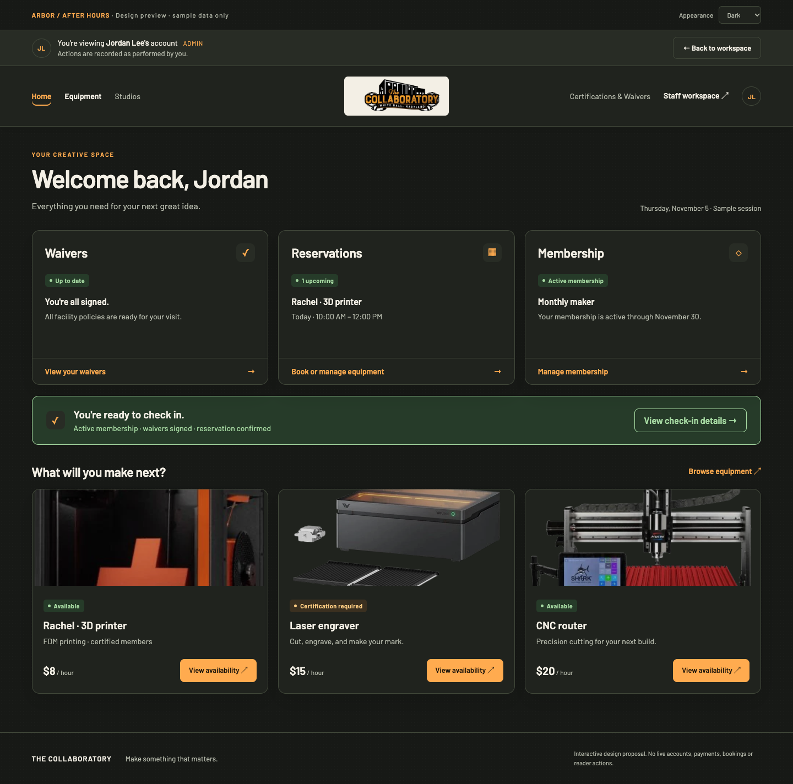
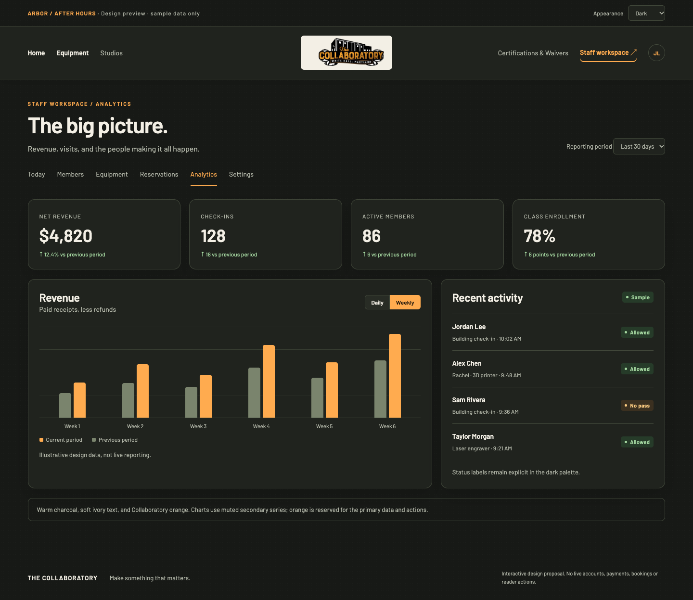
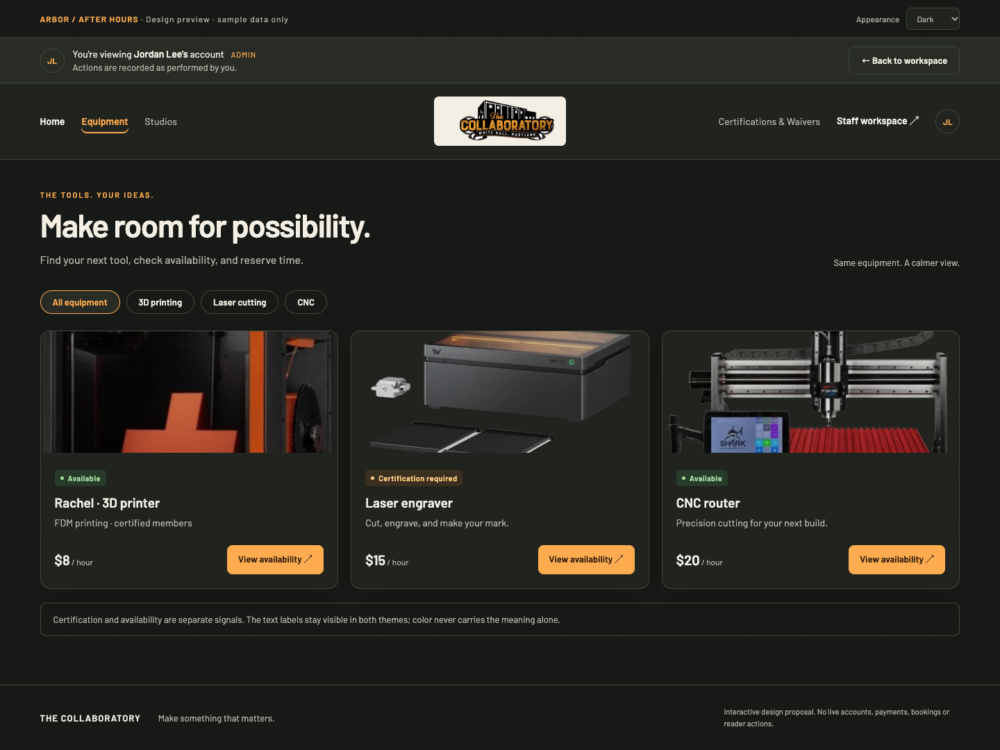
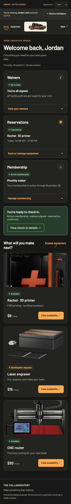
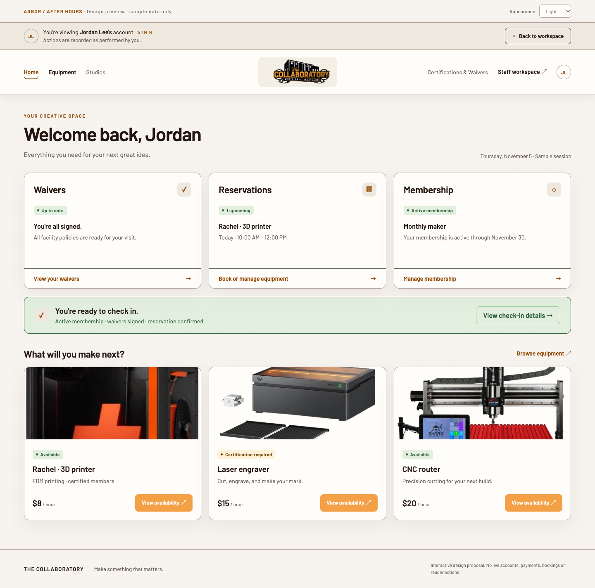

# ARBOR / After Hours

A **design-only** proposal for a dark appearance, retaining the Collaboratory's orange, Barlow typography, equipment imagery, and centered brand mark. This is a standalone interactive prototype, **not a shipped theme or a production screenshot**. All people, times, prices, status labels, totals, and chart values are illustrative fixtures. No API calls or live operations.

## Preview

From the repository root:

```sh
python3 -m http.server 5197 --bind 127.0.0.1
```

Open <http://127.0.0.1:5197/docs/design/dark-mode/>. Use the Home / Equipment / Staff workspace links and the Light / Dark / System appearance selector. Equipment filters, chart grouping, and workspace navigation work locally. Booking/payment/check-in buttons explicitly report that they are previews and make no changes. Stop the server with Ctrl-C.

## Mockups

### Member dashboard



### Staff analytics



### Equipment



### Phone



### Same layout in light mode (prototype comparison, not current production)



## Palette

| Role | Dark | Treatment |
| --- | --- | --- |
| Canvas | `#171916` | Charcoal with very quiet grain |
| Surface | `#20231e` | Cards, header, data panels |
| Raised surface | `#282c25` | Inputs, secondary buttons, staff banner |
| Primary text | `#f3efe5` | Soft ivory, no glaring white |
| Secondary text | `#b6baac` | Readable labels and supporting detail |
| Dividers | `#41483a` | Low-emphasis structural borders |
| Brand / action | `#ffab4f` | Orange focus rings, links, primary series, actions |
| Action text | `#21170c` | Dark ink on orange buttons |
| Positive | `#a6d9a2` on `#263b29` | Explicit status label plus color |
| Attention | `#ffce83` on `#3b3020` | Explicit reason, not color alone |

The logo retains its original colors on a small ivory plate instead of applying an inversion filter. Equipment photography stays recognizable; only the surrounding interface is themed. The member-account banner and navigation share a sticky stack, including on phones. Existing booking, eligibility, payment, and card-reader semantics are unchanged by this proposal.

## Appearance behavior

- Explicit Light / Dark / System selector; no ambiguous icon-only control.
- System follows `prefers-color-scheme`, including changes while open.
- This preview defaults to Dark and stores only its own namespaced preference (`arbor:design:appearance`), not the real site's settings.
- Production implementation should default to System, persist a browser preference, and set the resolved theme before the first paint to avoid a light flash.
- Visible keyboard focus, text-backed status meanings, and reduced-motion support.
- Decorative borders are intentionally subtle; production inputs and interactive outlines need a full non-text-contrast audit, not a blanket reuse of divider tokens.

## Implementation after design approval

1. Introduce semantic tokens for surface, text, border, action, focus, and status across the existing CSS files; keep the current light theme as the baseline.
2. Add an accessible shared appearance control and pre-paint theme bootstrap. No account, authorization, or backend changes.
3. Replace hard-coded light surfaces in Header/CardNav, forms, modals, tables, calendars, badges, tooltips, empty/error/loading states, and chart series. The prototype is not evidence that those real components have been migrated.
4. Verify complete member/staff/admin flows, contrast, keyboard navigation, phone layouts, OS preference changes, stored preference, and initial paint. Preserve existing sticky-banner and horizontal-overflow fixes.
5. Run the normal app checks before merging. This draft intentionally changes **only documentation/design artifacts**; there are no application imports, routes, dependencies, deploy changes, or production data edits.

## Assets

Existing logo and equipment images are referenced from `frontend/public/assets/`; their attribution remains in that directory's `CREDITS.md`. The two vendored Barlow font subsets retain their SIL Open Font License in `assets/BARLOW-LICENSE.txt`. No third-party CDN or external font request is required.

## Prototype verification

Headless Chromium: all 24 layout cases passed (three screens × two themes × 1440/768/390/320px), with no page-level horizontal overflow, broken images, failed requests, or JavaScript errors. The member-account banner remained at top zero after scrolling. Seven interaction checks passed: stored preference, OS preference changes, equipment filtering, inert booking feedback, workspace navigation/banner visibility, chart grouping, and range feedback. Six dark palette text pairs exceed 4.5:1 contrast (lowest measured 7.51:1); this is a limited palette check, **not a complete accessibility certification**. Screenshots are captured from this prototype. Application/backend suites were not run because no application code changed.
