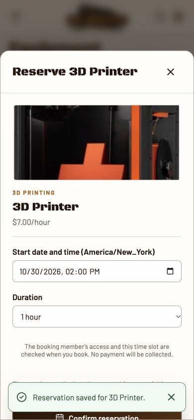
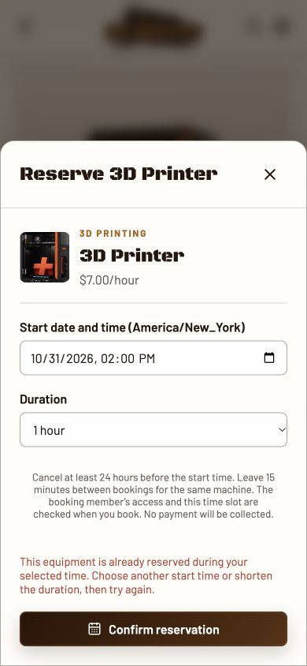
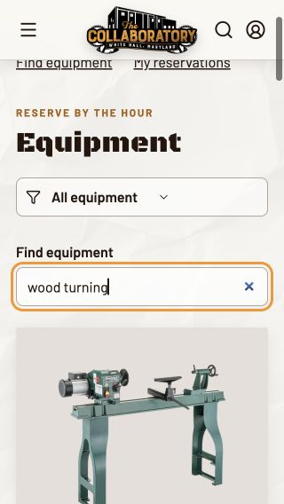
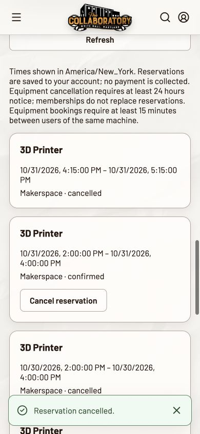
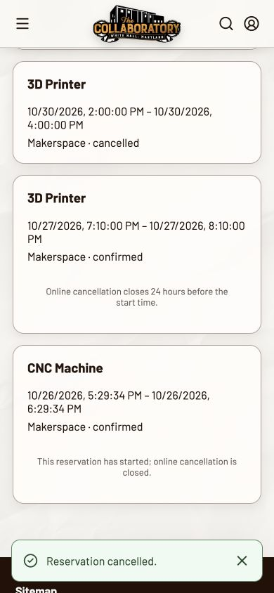

# Member reservations at phone size

Branch: `codex/mobile-member-reservations`, based on fetched main `69dd7a09700087c60f4ef48cb5aac7598c2b3e35`. This PR is independent of PR #59. Local Vite/Express application with an isolated PostgreSQL development database; only synthetic accounts and bookings were used. Tested in the in-app browser at **320 × 568** and **390 × 844** CSS pixels, America/New_York. This verifies responsive browser layouts, not physical iOS/Android keyboards or Safari behavior.

## Findings and changes

1. **Old success notification covered the next booking's error and action.** Book equipment, reopen it, then submit an overlapping time. The previous success toast stays above the modal, obscuring the lower form. Opening either reservation dialog and starting a mutation now clears the old toast. Errors receive focus so they scroll into view; equipment conflicts explain how to correct the time and retain the inputs.
2. **Finding an item or saved booking required scrolling the entire catalog.** At phone width equipment and studios occupy a long single column. Added name/type search and direct section shortcuts. Shortcuts scroll and focus without hash navigation, because the existing route guard remounts protected content on navigation. Search/filter state is preserved. Filter selects now have accessible names even when their visible label is hidden at phone size.
3. **The equipment image consumed much of a short phone's booking dialog.** Reduced only the small-phone equipment summary to a thumbnail beside the name/rate. The 390px conflict view fits the error and submit action together. On 320 × 568 the dialog remains vertically scrollable; error focus brings the message into view.
4. **Bookings inside the cancellation cutoff had no action or explanation.** Active reservations now explain that online cancellation closes 24 hours before the start; started bookings also explain why cancellation is closed. The existing rules are stated in the booking dialog before confirmation.
5. **Repeated form events could start duplicate requests before React disabled the button.** Ordinary browser double-clicking already resulted in one saved booking, backed by the existing server conflict checks. Added a synchronous in-flight guard and regression tests for two submit events in the same turn and repeated cancellation. This prevents duplicate client mutations; it does not add server idempotency or change overlap rules.

No horizontal overflow was observed in the catalog, saved bookings or equipment dialog at either width. Measured document widths matched the viewport (320/390px); the 320px modal's scroll width matched its client width (318px). No overflow-only workaround was added.

## Verification

| Scenario | Steps and actual result |
| --- | --- |
| Find equipment | Search `wood turning` at 320px; only Wood Lathe remains. Search `3D` to choose the printer. Name/type matching ignores case. Section shortcut reaches My reservations while retaining the search. |
| Choose time / book | Choose 31 Oct 2026, 14:00, two hours; double-click Confirm. One 14:00–16:00 booking appears, confirmed. The integration test also asserts one POST and one database row with a two-hour duration after two immediate submit events. |
| Overlap | Reopen printer and choose 14:00 on the same day. Server rejects it; error explains changing start/duration, focus reaches the alert, and the chosen time remains. No second row is created in the integration test. |
| Buffer boundary | Try 16:00 immediately after the two-hour booking: rejected with the existing 15-minute message. Try 16:15: succeeds. Browser and HTTP/PostgreSQL tests both exercised this. |
| Cancel | Cancel the synthetic future booking, including a double click: status becomes cancelled. Unit test asserts one cancellation request. All browser-created future test bookings were cancelled during cleanup. |
| Cancellation cutoff | Existing booking less than 24 hours away has an explanation and no Cancel action. Integration test creates a near-term booking and confirms direct API cancellation returns 409 / CANCELLATION_NOTICE_REQUIRED. |
| Invalid time | Unit test submits a past time: no booking POST, clear future-time message, input preserved. |
| Failed save / retry | Unit test holds the request, submits twice, rejects with conflict, verifies one request and retained input, then changes time and retries successfully. |

- `npm run check --prefix frontend`: **82 unit tests passed** and production build passed. Five new component regressions.
- `PGHOST=127.0.0.1 PGPORT=25434 PGUSER=arbor_mvc PGDATABASE=arbor_mvc_dev npm run test:integration --prefix frontend -- --maxWorkers=1`: **27 integration tests passed**, including the new member flow through real Express/PostgreSQL.
- `git diff --check`: passed.
- Initial integration attempts identified a sandbox loopback restriction and a test wait that observed old rows before a reload; the final runs use permitted loopback access and wait for both new bookings. Neither was treated as a product pass.

Pricing, payment behavior, membership/waiver/training eligibility, overlap/cooldown rules, duration limits and cancellation policy are unchanged. There are no backend changes or migrations. No real charge, merge or deployment was performed. Max owns the merge/deployment decision.

## Screenshots

Before: old success notification covers the lower conflict form at 390px.

After: compact summary, preserved time, actionable conflict and visible submit at 390px.

Find equipment by type at 320px.

Cancellation saved at 390px.

Cancellation cutoff and started-booking explanations at 390px.

