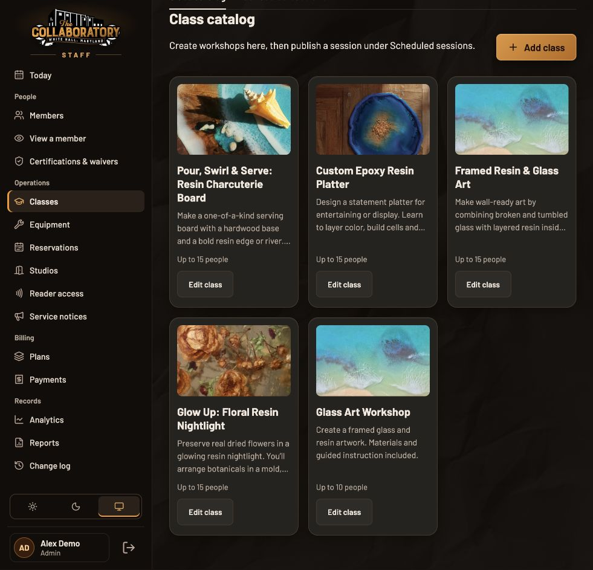
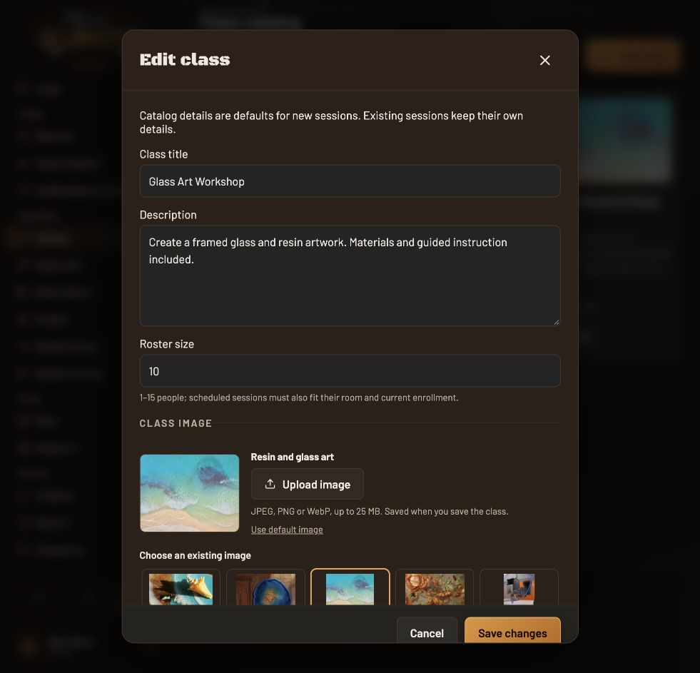
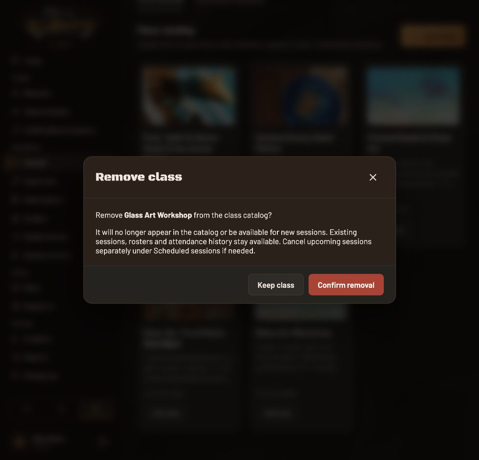
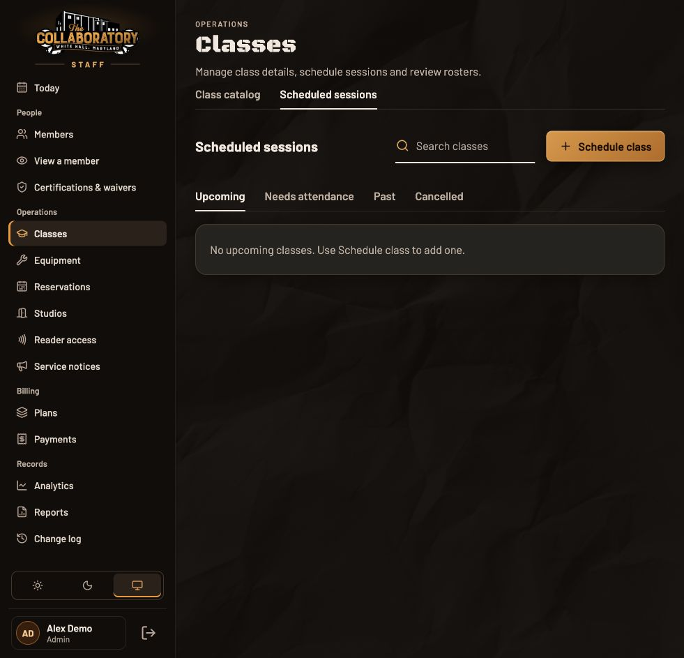

# Staff class management

Based on `origin/main` at `2ba851ee`. The staff workspace now has a Classes section with a reusable workshop catalog and scheduled-session controls.

- Add and edit catalog titles, descriptions, images and roster limits.
- Upload JPEG, PNG or WebP images through the equipment image picker, or choose a built-in class picture or HTTPS image URL.
- Edit upcoming session titles, descriptions, images and roster limits independently of catalog defaults.
- New workshop sessions copy their catalog image. Catalog changes do not rewrite existing sessions.
- Server checks enforce staff permissions, CSRF, revisions, the 15-person class limit, room capacity and existing enrollment. Updates lock the same class row as registration and record staff audit events.
- Migrations 057 and 058 add catalog revisions, image storage and audit coverage without changing historical migrations.

## Browser verification

Used the isolated Docker demo at http://localhost:8083/admin/classes with Admin demo:

1. Opened Classes from the staff sidebar.
2. Added Glass Art Studio with a description, the resin-and-glass image and eight seats.
3. Reopened it and verified all four values persisted.
4. Changed the title to Glass Art Workshop and the roster size to ten, saved, and verified persistence after reloading.
5. Checked the Scheduled sessions view and its scheduling controls.

## Automated verification

- Backend `npm run check`: build, test type checking and 158 unit tests passed.
- Frontend `npm run check`: 1,177 tests and production build passed.
- Backend PostgreSQL integration suite: 704 tests passed after the audit fix.
- Frontend PostgreSQL integration suite: 43 tests passed.
- Final focused class and equipment UI regression run: 63 tests passed; backend test type checking also passed.
- Final Docker application and database health checks passed.
- New database coverage exercises catalog authorization, duplicate titles, stale updates, audit events, inherited session images, roster shrink protection, room limits, closed-session edits, upload validation and image delivery.
- Focused regression coverage includes existing class scheduling, class UI and equipment image workflows.

The initial full backend integration run caught missing audit coverage for the image table; migration 058 adds the same change-capture and truncate-protection triggers as equipment image storage.

## Follow-up: removal and tab layout

- Edit class now includes Remove class with confirmation. Catalog removal is revision checked, permission checked and audited; existing sessions and enrollment remain intact. Removed catalog entries cannot be used to publish new sessions.
- Migration 059 adds the removal timestamp without rewriting earlier migrations.
- Both management panels stay mounted, preserving schedule search and filters. The workspace schedule no longer replays its entrance animation. Tab switching uses the shared height hold and keyboard navigation.
- Fixed the root page width (auto margins inside the workspace grid otherwise shrank the page to each tab's contents), added 28px above panel contents, matched subsection headings and allowed the scheduling toolbar to wrap.
- Follow-up verification: backend build/test type checking, 13 PostgreSQL integration tests (class management, scheduling and audit migration regression), 45 class UI tests, frontend production build and Docker health checks passed.
- Browser: removed the synthetic Glass Art Workshop created during the original test, verified it stayed absent after reload, switched panels repeatedly and verified search persistence. Both panels measured left=280px and width=673px in the same viewport.

